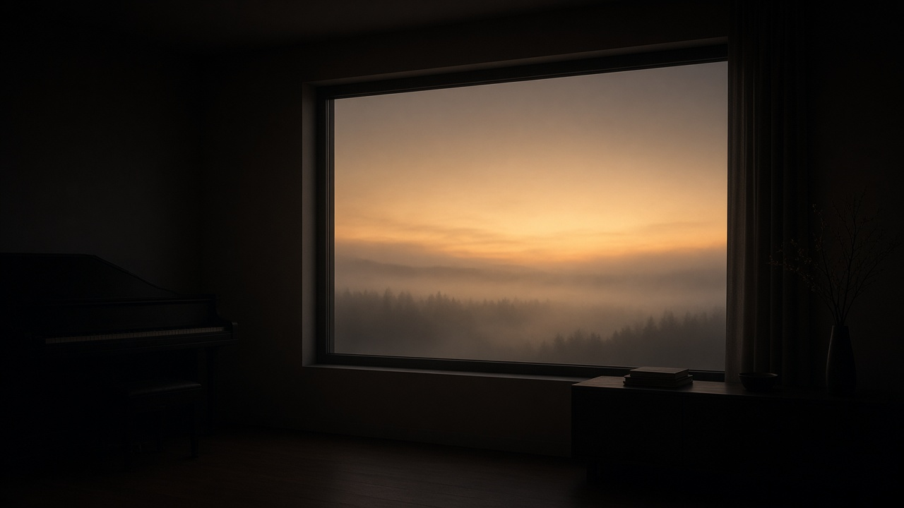

# Lumen Drift: MIDI pad progressions that leave room for bass and melody

**Subtitle:** Fifty original nocturnal loops, written as sustained pads. What is in the files, how the harmony is voiced, and what was actually checked.

**Suggested Medium tags:** Music Production, MIDI, Electronic Music, Synthwave, Composition

**Hero image:** `web/public/images/medium-hero-lumen-drift.jpg`

A dark room, a piano in silhouette, and a window onto fog with a warm horizon above a tree line. The picture is a mood reference. It does not contain the harmony, and it does not claim a recording.

**Status of this draft:** Written for Medium. It was not posted to Medium in the session that produced the files. The listening room that plays the loops is the static site in this repository.

Lumen Drift is a set of fifty MIDI pad progressions for atmospheric electronic arrangements. A producer loads one loop under a sustained synth, then writes bass, melody, and drums around it. The MIDI holds pitch, timing, and velocity. It does not hold the sound. A plain pad patch should still make the harmony legible. Width, bloom, and the sense of a room come from the instrument, the envelope, and the effects.

The set is free to download. There is no account. A paid sample pack with finished sounds does not exist in this release, and this article does not invent a price for one.

## What a pad part is for

Most "pad progression" posts hand you chord symbols and leave the voicing as an exercise. That is a chart, not a part. A pad fails in a mix for ordinary reasons: the left hand sits on the bass, the right hand occupies the melody, the chord changes every bar whether or not the harmony needed to move, and the same pitch is retriggered so the synth never sustains.

Lumen Drift is the other object. Each file is one polyphonic part on MIDI channel 1. Common tones are held as single notes. Low notes are sparse, so a separate bass has somewhere to speak. The top of the pad usually stops before it crowds a lead. Harmonic rhythm is uneven. Some loops change twice. One changes eight times. None of them is a drum pattern, an arpeggio, or a topline.

The tempo is still written down, as an integer from 70 to 115 BPM. The loops that were actually composed use 70 through 110. A slow pad can feel nearly beatless at 70. The clock is there so a DAW can lock the file to the song. The file will not infer its own loop. The index states 4, 8, or 16 bars, which is 7,680, 15,360, or 30,720 ticks at 480 ticks per quarter.

## Climate, not a template

The atmosphere is nocturnal synthwave and darkwave, heard with a wider ambient patience. Four names are useful as climate and useless as templates: the long tones associated with Brian Eno, the emotional pressure associated with Jon Hopkins, the worn color associated with Boards of Canada, and the luminous major writing associated with Tycho.

Nothing here is a reconstruction of a recording. No progression is labeled as one of those artists' pieces. Chord choices do not reproduce a person's recorded sound. If a loop reminds you of a record, that is a family resemblance in the room, not a quote. The test used during the build was stricter than taste: the same pitches, durations, and start times, ignoring velocity and tempo, must not match another loop, and must not be that loop shifted by a constant interval.

## The rules that changed the chords

Every loop is in 4/4. Each one names one primary tonal center and one pitch collection. The collections in the fifty files are Dorian (11), Aeolian (11), Mixolydian (8), Phrygian (7), Ionian (6), harmonic minor (4), and Lydian (3). Aeolian is the only name used for natural minor. Listing "natural minor" beside Aeolian would have pretended that one set of pitches was two ideas.

Roman numerals are measured from the parallel major of that tonic and stay there. In C, A-flat major is bVI and F minor is iv. When a chord borrows a tone, the index says so. Ten of the fifty loops borrow. The other forty stay inside the named collection. Borrowing is not hidden inside a friendly symbol. Faded Major, in C Mixolydian, ends on C6 rather than Cmaj7 because B, the leading tone, is outside Mixolydian. The borrowed chord in that loop is Fm6, which brings A-flat in.

A harmonic event is a new chord, a real revoicing, or an internal change such as a suspension resolving. Holding the same chord and striking it again does not count. Each loop has between two and eight events. Across the set: two loops have three events, twenty-two have four, fifteen have five, nine have six, one has seven, and one has eight. The eight-event loop is Ember Line, B Dorian, 104 BPM, four bars. Two loops have three events. Still Water, A Aeolian, 70 BPM, sixteen bars, is the long one: Am(add9), Fmaj7, Am7. A, C, and E can run through all of them. Afterglow is the short one: G Mixolydian, 90 BPM, four bars, G6/9, Fmaj9, Cadd9.

Intended voicings are usually three to six notes, inside MIDI 48 to 84, with 36 to 96 as a hard outer limit that these files barely use. Adjacent notes inside a chord are kept at least three semitones apart, so a major seventh is a major seventh or wider, and a flat nine is a minor ninth rather than a cluster. At most one note sits below MIDI 50. The preference window is roughly 50 to 81, which leaves a bass underneath and, on the Open Horizons loops, air above.

There is no pitch bend, sustain pedal, modulation, or expression. Velocity moves gently, mostly between 52 and 84, and the part still makes sense if the patch ignores velocity. Same pitches never overlap. Different pitches may overlap for a moment at a chord change. No more than twelve MIDI notes are active at once. That limit is about the file, not about how many voices a synth allocates to a release tail.

The loop seam is structural. If a tone should continue into the next pass, it ends on the last tick and starts again at tick 0. A long release will smear those two notes together in audio. The MIDI does not encode that smear, and a long release does not turn the join into a written crossfade.

## Five groups, with the chords on the page

The groups are frames, not molds. Progressions inside a group do not share a roman sequence. After the last revision, no two loops share a harmonic-rhythm duration tuple either. That was checked, not assumed.

### Suspended Light

Open intervals, slow change, a little ambiguity.

Glass Harbor is D Dorian at 74 BPM, eight bars. The chords are Dm6, Gadd9, Cmaj9(no3), Dm11(no3). The first voicing is D4, F4, B4, A5. F moves to G. The third chord withholds its third and lets C in against a shell that already holds G and B. The last chord puts the third away again and keeps D and A, which restart at the downbeat. The highest note is C6, MIDI 84, the top of the primary range. There is nothing under D4. A bass owns that register.

Still Water, mentioned above, is the longest breath in the group: sixteen bars, three sonorities, 70 BPM.

### Emotional Currents

One voice moves, then another. Tension is allowed to sit.

Veiled Pulse is G Dorian at 93 BPM. It stays diatonic until the sixth chord. Gm9 becomes Gm7(add11) when A moves to C. Bbmaj7, C7sus4, and Cadd9 follow. Then Ebmaj7, borrowed from Aeolian, and a return to Gm(add9). The ledger spells the color tones Bb and Eb, not A# and D#. The collection is G Dorian, so Bb is the minor third. Eb is the borrowed tone, and the index names the chord.

Ember Line is the opposite density: eight chords in four bars at 104 BPM, B Dorian, each event two beats long. The first and last voicing match, B3 D4 A4 F#5, which is a return, not a new event hiding inside the loop. Between them the color changes: Bm(add9), Bm6, Eadd9, A6 on bVII, F#m9, and C#m7, before the tonic seventh comes back.

### Faded Memory

Bittersweet modal color, and a few chords that do not belong to the scale.

Sepia Interval is D Aeolian at 72 BPM. Dm9, Bbmaj7, and Gm7 can live inside the mode. The last chord, Gadd9, cannot. Its B is the raised sixth, borrowed from Dorian. The note is spelled B4, because the chord writes a major third on G. It is not Cb. Cb appears in this collection only when the letter really is C flat, as in the Eb pieces.

Half-Remembered is the Neapolitan cousin: B Aeolian, Bm9, Em7, then Cmaj7, which is bII and outside the mode, then Gmaj7. Postcard from Rain borrows Gbmaj7 into Bb Dorian. Worn Film puts a Neapolitan Bbmaj7 inside A harmonic minor, and withholds the leading tone on E7sus4 before the loop comes home.

### Open Horizons

Warmer voicings, and a ceiling left for a melody.

Kindling is D Mixolydian at 110 BPM, the fastest loop in the set. It opens on D6/9, voiced A3, D4, F#4, B4, E5. The next chord is Cmaj7, the Mixolydian bVII, which is diatonic: the major seventh of C is B, and B is the sixth of D Mixolydian. Later, Bm7 keeps B, D, F#, and A, and lets E go. That matters. An earlier draft labeled a chord vi7(add11) while it still contained every pitch of the opening 6/9. Same pitches are not a new chord. E had to leave before vi7 was allowed to stand.

The major and Lydian loops in this group (Window Seat, Late Sun, Open Table, Glass Prairie, Harbor Major, Soft Meridian) sit higher or thinner on top so a lead can enter without fighting a doubled melody note inside the pad.

### Nocturnal Bloom

Darker harmony, suspensions, and registers that open.

Moon Garden is C harmonic minor at 76 BPM. The order is Cm(maj7), G7, Abmaj7, Dm7b5. The dominant arrives before bVI, and the loop ends on a half-diminished ii. B, the major seventh, is in the collection. The voicing of the first chord is G3, C4, B4, Eb5. Eb is the minor third, spelled from C harmonic minor, not D#.

Violet Hour is not that piece. It is D Phrygian at 78 BPM, voiced higher: Dm7, Ebmaj7, a long Cm7 on bVII, and Dsus4. The suspension withholds F. The opening chord gives the third back when the loop restarts. Its durations are not Moon Garden's durations. Old Station, the other Phrygian loop that used to share a roman outline with an earlier Violet Hour, is F# Phrygian and moves i7, bIImaj7, bVImaj7, iv7. Violet Hour does not.

Low Chapel, F harmonic minor, 72 BPM, sixteen bars, is the loop where a suspension is the point. C7sus4 withholds E. C7 lets E in. The tonic that follows is Fm(maj9), not Fm9, because Eb would be outside harmonic minor and E is already the color.

## What was checked, and what was not

The build writes Format 0 MIDI, one track, 480 ticks per quarter, with the pattern name, the tempo, and a 4/4 time signature at tick 0. It then opens those bytes again and parses them. The note table in the CSV has to match the parsed notes in pitch, start tick, duration, and velocity. Beat columns are ticks divided by 480, checked within a documented rounding tolerance. Tempo in the file is the nearest integer number of microseconds per quarter note, half-up, and every integer BPM from 70 through 115 round-trips through that encoding. The loops in the set only use 70 through 110. The wider test is there so a later loop at 111 does not get a tempo meta that reads back as a different BPM.

Harmonic events partition each loop. They do not overlap and they do not leave a gap. A note may enter late, leave early for a release, or hang into the next chord. The event still names the harmony of that span. Chord symbols do not claim extensions that are not in the voicing. `maj7(#11,no5)` omits the fifth on purpose, so the raised eleventh is not a semitone away from it. Suspensions say, in the comment, that the third is absent.

Duplicate detection ignores velocity and BPM, and ignores the order of notes that start together. It rejects an exact copy. It rejects a copy transposed by one constant. It splits held notes at segment boundaries and rejects a longer file that is a shorter loop repeated unchanged. Internal repetition is allowed. Ember Line may end where it began. That is a cadence, not a hidden clone of a two-bar loop, and the segment test is what makes the distinction.

Shared roman sequences and shared harmonic rhythms are reported for a person to read. On the build that produced this draft, both lists were empty. That is a file fact. It is not a claim that every loop feels unrelated in a mix.

A score pass then lists, for each file, how many chord boundaries keep a common MIDI pitch, how many pitches the seam shares, and the lowest and highest note. Every loop in that pass keeps at least one common pitch on at least one boundary, counting the seam. This is still a reading of the data. It is not listening.

What was not done: the MIDI was not rendered to audio in the build, the loops were not auditioned, and a DAW was not asked to cycle them. The listening room can play a preview through a small browser synth: detuned oscillators, a lowpass, and an envelope chosen from the suggestion text. That synth is not in the file. Hearing it in a browser, later, is a separate act from the validation report. This draft does not describe a listening session that did not happen.

The published digest in the validation report hashes the fifty MIDI files and the three CSV tables. It does not hash the zip. The zip also contains the report, so a hash of the zip cannot honestly be written inside the report and then packed into the zip.

## How to use one loop

1. Import the MIDI. Set the DAW loop to the bar length in the index: 4, 8, or 16. Do not assume the host will guess.
2. Load a sustained pad. Slow attack for the long events. A moderate attack for Ember Line and the other two-beat changes, or the attack will blur chords that were written to be distinct.
3. Put the bass below the pad. If the part's lowest note is already D4, you have more than an octave of room. If a loop reaches E3, keep the bass simpler there.
4. Write the melody above the pad, or in the gaps the voicing left. Open Horizons is the group that planned for this. The other groups often leave the same room, with less of a promise.
5. Treat the sound and treatment columns as notes to yourself. Slow filter movement, a little pitch drift, restrained chorus, gentle saturation, a reverb send, or nothing. They are not controller lanes.
6. If you need the same progression in another key, transpose it in the session. A transposed copy is not a new composition in this library, and the duplicate check would reject it if someone tried to file it as one.

## What this is not

It is not a reconstruction kit for four famous discographies. It is not a drum rack, a bassline pack, or a lead library. It is not a claim that the browser preview is a finished mix, or that anyone has sat and approved the loops by ear as of this draft. It is not a mailing list.

It is a voiced harmonic library with the paperwork beside it: an index, a note list, a harmonic-event list, and a validation report that says which checks ran. The listening room groups the fifty loops, draws the piano roll from the same note list the MIDI contains, and draws the common tones between chords. Play one. Read the voicing. Download the file. Put a bass under it.

Start with Glass Harbor if you want the method in one loop: D Dorian, four chords, D and A crossing the seam, and nothing in the way of the low end.
